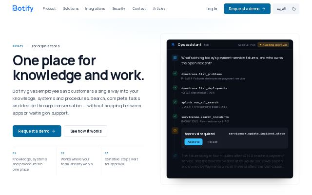
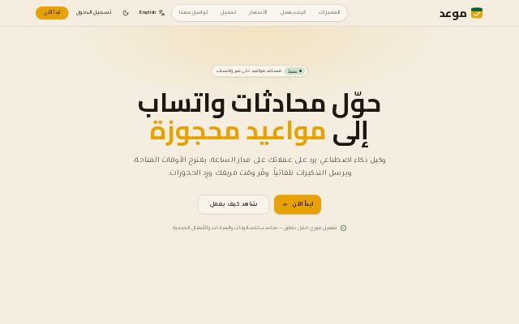
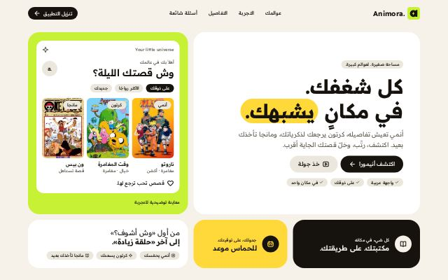
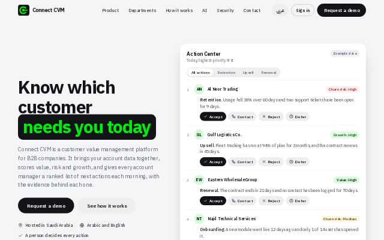
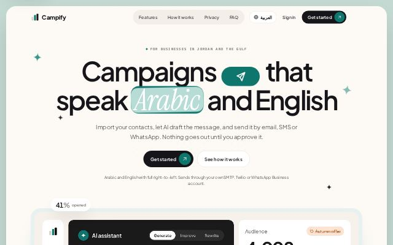
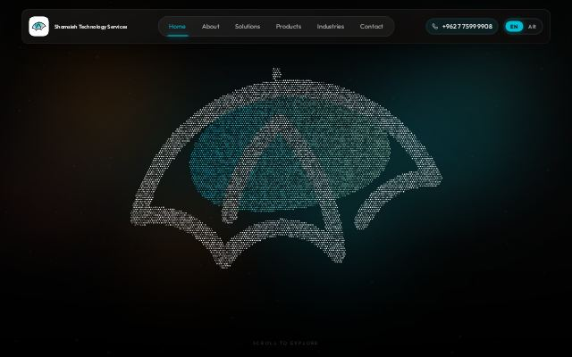
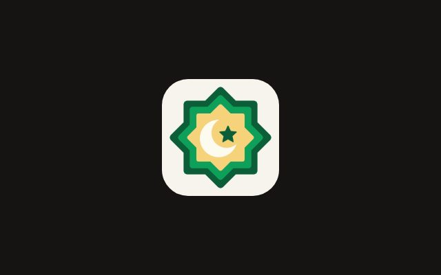
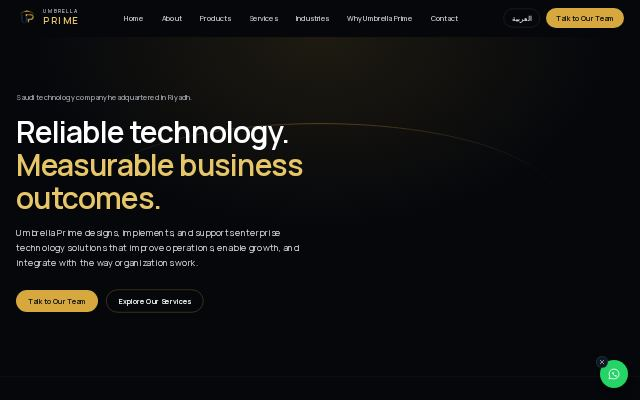

  
  
  

I turn ideas into products that ship. I work across every layer: **architecture, backend, interface, mobile, infrastructure**, and the **AI** that ties them together — from the first line of a spec to thousands of real users.

- 🤖 Building **AI agents** that answer, book and act on WhatsApp, Telegram, Slack, the web and voice.
- 🏗️ Shipping **multi-tenant SaaS** on clean architecture: Go, TypeScript, Java, .NET, Postgres, Temporal.
- 📱 Publishing **mobile & desktop apps** with Expo and Tauri — offline-first, Arabic-first.
- 🌍 Arabic and RTL built in from day one, not patched on.

| | |
|---|---|
| **AI agents & LLM** | Memory, tools, approvals, RAG, MCP, voice · `LLM` `RAG` `MCP` `pgvector` `Claude` `Gemini` |
| **Multi-tenant SaaS** | Billing, roles, data isolation, consoles, campaigns & journeys · `RBAC` `RLS` `Billing` |
| **Backend & systems** | APIs, workers, queues, long-running workflows · `Go` `Node` `Java` `.NET` `Temporal` `Redis` |
| **Web** | Fast bilingual sites tuned for SEO & GEO, rich web apps · `Next.js` `React` `Astro` `TypeScript` |
| **Mobile & desktop** | Store apps that work offline, with sync and notifications · `Expo` `React Native` `Tauri` `Supabase` |
| **DevOps & cloud** | Docker, CI/CD, VPS & AWS, backups, monitoring · `Docker` `Caddy` `AWS` `GitHub Actions` |
| **ERP & business** | Odoo implementation, integrations, decision platforms · `Odoo` `Python` |
| **Brand & design** | Identities, design systems, launch videos · `Design Systems` `Remotion` |

<table>
<tr>
<td width="50%" valign="top"> <b><a href="https://botifyarabia.ai">Botify ↗</a></b> · AI platform Build AI agents for your business: memory, tools, approvals, web widget, WhatsApp, Telegram, Slack and voice.</td>
<td width="50%" valign="top"> <b><a href="https://gomawid.com">Mawid AI ↗</a></b> · WhatsApp AI An AI assistant that answers enquiries and books appointments on WhatsApp for Gulf businesses, with a desktop app.</td>
</tr>
<tr>
<td valign="top"> <b><a href="https://animora.farajai.com">Animora ↗</a></b> · Platform Arabic-first anime & manga: streaming catalog, manga reader, library, social and a staff dashboard. Go backend.</td>
<td valign="top"> <b><a href="https://connectcvm.com">ConnectCVM ↗</a></b> · Enterprise Customer-value platform for telcos: scoring, offers, governed journeys, real-time decisions and an AI agent.</td>
</tr>
<tr>
<td valign="top"> <b><a href="https://campify.ai">Campify ↗</a></b> · SaaS AI-assisted email, WhatsApp and SMS campaigns for SMEs, in Arabic and English.</td>
<td valign="top"> <b><a href="https://shamsieh.com">Shamsi ↗</a></b> · AI agent Education assistant for parents and students in Jordan and Egypt, answering only from platform data.</td>
</tr>
<tr>
<td valign="top"> <b><a href="https://play.google.com/store/apps/details?id=com.flamux.qareeb">Qareeb ↗</a></b> · Mobile · Google Play Quran, recitation, prayer times & azan, qibla and adhkar. All data stays on the device.</td>
<td valign="top"> <b><a href="https://umbrellaprime.sa">Umbrella Prime ↗</a></b> · <a href="https://aiodyx.com">AIODYX ↗</a> · <a href="https://raqmeiat.com">Raqmeiat ↗</a> Bilingual corporate websites for enterprise software, Odoo and ICT companies in Saudi Arabia and Jordan.</td>
</tr>
</table>

Have an idea, a product to grow, or want AI doing the work for you? **[farajai.com](https://farajai.com)** · **[hello@farajai.com](mailto:hello@farajai.com)**

BUILD · CREATE · GROW — MORE THAN A MOMENT · أكثر من لحظة

